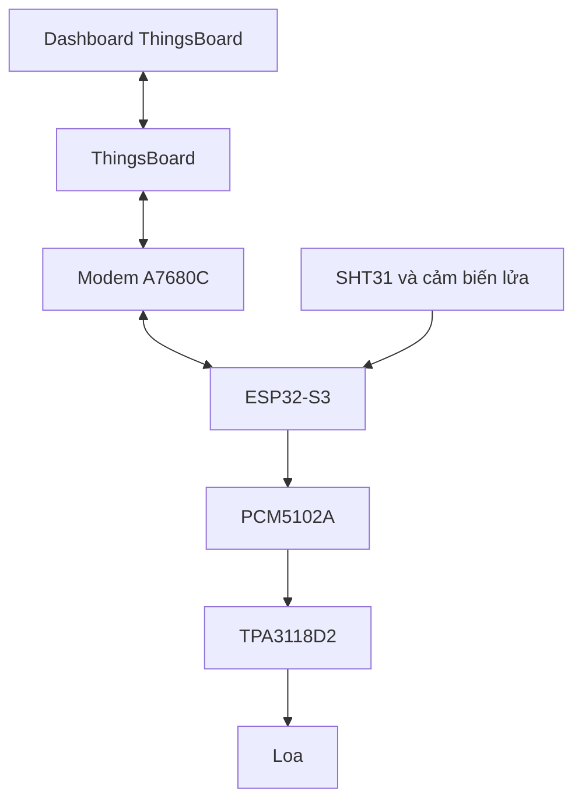

# IoT Monitoring & Broadcast

Hệ thống giám sát nhiệt độ, độ ẩm và báo lửa; nhận văn bản hoặc MP3 từ ThingsBoard để phát qua loa. ESP32-S3 xử lý cảm biến, truyền dữ liệu qua modem 4G và điều khiển âm thanh. Cảnh báo lửa được ưu tiên tại thiết bị.

## Sơ đồ hệ thống

## Phần cứng

| Khối | Thành phần | Thư mục |
|---|---|---|
| Điều khiển | ESP32-S3, nguồn và USB | hardware/esp32-controller |
| DAC | PCM5102A | hardware/audio-dac |
| Khuếch đại | TPA3118D2 | hardware/power-amplifier |
| Truyền thông | Modem A7680C qua UART | Module ngoài |
| Cảm biến | SHT31 và cảm biến lửa digital | Kết nối GPIO |

Tên file KiCad bên trong mỗi thư mục được giữ để bảo toàn liên kết project. Thư viện tùy chỉnh rời và model 3D chưa đầy đủ; cần bổ sung trước khi cập nhật linh kiện từ thư viện. Chạy ERC/DRC và tạo Gerber từ PCB trước khi gia công.

## Dùng nhanh

1. Copy `firmware/School_Node/secrets.example.h` thành `secrets.h` cùng thư mục; cấu hình riêng không đưa vào Git.
2. Mở `School_Node.ino` trong Arduino IDE. Cấu hình Arduino-ESP32 3.3.2, ArduinoJson 7.3.2 và flash/PSRAM theo module thực tế.
3. Import `thingsboard/dashboard.json`, chọn lại entity alias và thiết bị điều khiển.
4. Đọc [hướng dẫn sử dụng](docs/usage.md), đặc biệt phần giới hạn TLS, trước khi kết nối dịch vụ.

**Trạng thái TLS:** chỉ có cấu hình TLS cho TTS. HTTPS tới ThingsBoard hiện bị từ chối với mã `-12`; chưa hỗ trợ TLS ThingsBoard hoàn chỉnh. HTTP không bảo vệ token và nội dung trên đường truyền. Không dùng HTTP cho triển khai thực tế có dữ liệu hoặc thông tin xác thực cần bảo vệ.

## Cấu trúc

- `firmware/School_Node`: firmware Arduino và cấu hình mẫu.
- `hardware`: schematic, PCB, project và BOM có sẵn.
- `thingsboard`: một dashboard và mã nguồn widget.
- `tests`: kiểm thử upload, widget và giải mã MP3 trên máy tính.
- `docs/usage.md`: cấu hình, giao thức và xử lý lỗi.

Giới hạn ứng dụng: tối đa 128 KiB văn bản UTF-8, 2 MiB MP3 khi đủ PSRAM; mỗi chunk tối đa 1536 byte. Giới hạn thực tế phụ thuộc bộ nhớ khả dụng.

Xem [kết quả kiểm thử](tests/VALIDATION.md) và [lịch sử thay đổi](CHANGELOG.md). Quyền sử dụng được nêu trong LICENSE; thư viện bên thứ ba có điều khoản riêng trong THIRD_PARTY_NOTICES.txt.
